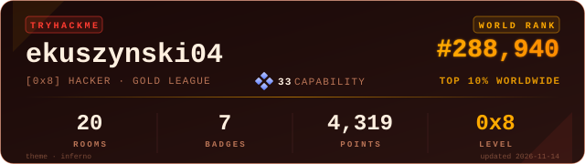

## Hello I'm Eryk 👋

I'm a First Class Software Engineering graduate developing my skills in Cybersecurity and IT Infrastructure.

I'm particularly interested in Blue Team security and security monitoring. I enjoy building practical projects to develop my technical knowledge and gain hands on expierience with real life technologies.

My goal one day is to build a career in IT and working full time in cybersecurity.

## 🔐 Cybersecurity Projects 🔐

### `Mini Nmap`

A Python based network scanning tool developed to learn TCP/IP networking with the inclusion of socket programming.

- TCP and UDP scanning

- Port status detection and error handling

- Input validation and configurable scan options

### `Active Directory Security Lab`

A practice Windows Active Directory lab designed about a fictitious educational organisation.

- Active Directory architecture

- Group Policy and access control design

- Administrative security

- Planned SIEM integration and security monitoring

## 🛠️ Technologies and Skills 🛠️

- **Languages** - Python and PowerShell 

- **Infrastructure** - Windows Server and Active Directory

- **Tools** - JIRA, Git and GitHub

## 📚 Currently Learning 📚

- Windows Active Directory administration

- SIEM deployment and event analysis

- Network security and monitoring

- Blue Team Operations and threat detection
  
